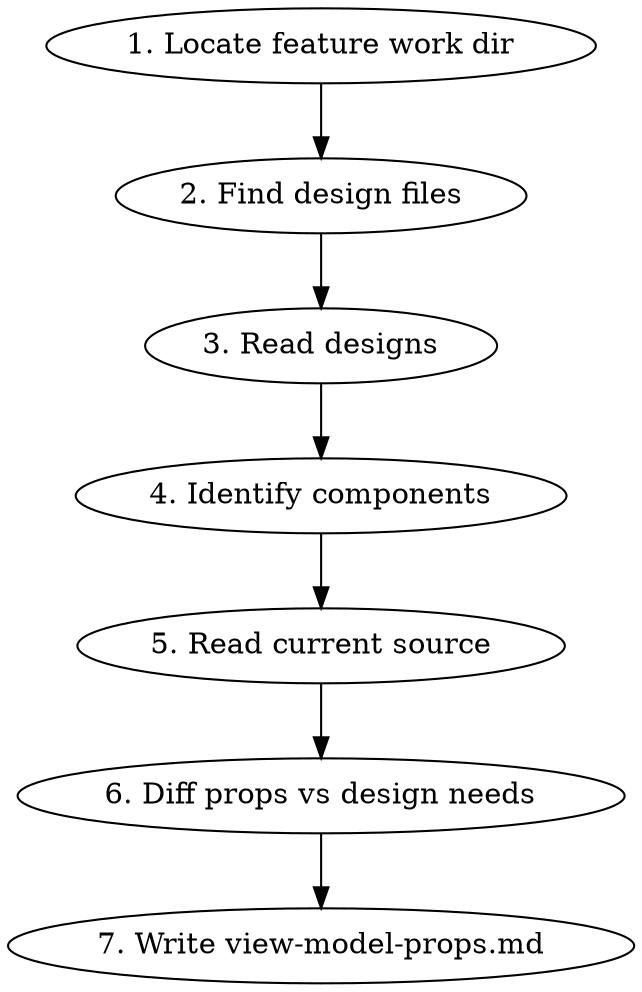

# View Model Props

## Overview

Analyzes finalized UI designs and produces a `view-model-props.md` file documenting every UI component involved in the change — its current props and the new/modified props required to render the design.

## When to Use

After UI design iteration is complete (final/ folder exists or last iteration is chosen). Before implementation planning or coding begins.

## Process



### Step 1 — Locate feature work directory

Ask the user which feature if not obvious from context. The work dir is `a-works/{category}/{PROD-XXX-name}/`.

### Step 2 — Find design files

Priority:
1. `ui-design/**/final/desktop.md` (or `mockup.html`)
2. If no `final/` — highest numbered `iteration-{N}/` — pick variation with most detail
3. Read desktop version only (sufficient for prop extraction)

Read ALL final desktop files across sub-sections (e.g., `add-edit/final/desktop.md`, `overview/final/desktop.md`, `review-sign/final/desktop.md`).

### Step 3 — Read conventions

Read: `/a-kb/conventions/home/react/react-component.md`

Also scan 2-3 existing components in the affected area to extract meta conventions:
- Prop typing style (inline vs separate type)
- Naming patterns (snake_case data, onX callbacks)
- Grouping order (Data -> UI State -> Callbacks)

### Step 4 — Identify components

From the design files, identify:
- **Existing components** being modified (search codebase for matching component names/files)
- **New components** that need to be created (elements in design with no current implementation)

Use Grep/Glob to find actual component source files.

### Step 5 — Extract current props

For each existing component found, read the source file and extract:
- Component name
- File path
- Full current prop type/interface (every prop with its TypeScript type)

### Step 6 — Determine new/changed props

Cross-reference design requirements with current props:
- What new props are needed?
- What existing props need type changes?
- What props are being removed?

### Step 7 — Write output

Create `view-model-props.md` in the feature work directory.

## Output Format

One TypeScript type block per component. Single block — not current vs updated side by side.

**Annotation rules:**
- **Unchanged props:** written as-is, no comment
- **Modified prop:** old line struck through, new line below it with `// [modified] reason`
- **Removed prop:** struck through with `// [removed] reason`
- **Added prop:** new line with `// [added] reason`

This keeps the type scannable — you only look at annotated lines to see what changed.

````markdown
# View Model Props — {PROD-XXX Feature Name}

## Existing Components

### {ComponentName}
**File:** `{relative/path/to/file.tsx}`

```typescript
type ComponentNameProps = {
  data_prop: string
  ~~changed_prop: string~~
  changed_prop: string | null // [modified] now nullable for X reason
  ~~old_prop: OldType~~ // [removed] no longer needed because X
  on_action: () => void
  new_prop: string // [added] needed for X from design
}
```

---

## New Components

### {NewComponentName}
**Suggested file:** `{relative/path/to/new-file.tsx}`
**Reason:** {brief why from design}

```typescript
type NewComponentNameProps = {
  data_prop: SomeType
  on_action: () => void
}
```
````

## Prop Convention Rules

Follow these when suggesting new props:

1. **Typing:** Props defined inline per project convention. Use separate `type` alias only if the component is reusable AND the team already does this in that area of the codebase
2. **Grouping order:** Data props -> UI state props -> Callback props
3. **Data props:** snake_case (`form_data`, `timesheet_id`)
4. **Callbacks:** `onX` for simple (`onSuccess`, `onCancel`) or `on_x_action` for domain actions (`on_approve_entry_action`)
5. **Defaults:** Specified via destructuring default, not in type
6. **No `any` or `as` casts** — use proper union types
7. **Boolean props:** Positive naming (`disabled`, `visible`), not negative (`notHidden`)

## Common Mistakes

| Mistake | Fix |
|---------|-----|
| Guessing props without reading source | Always read actual component file first |
| Missing callback props for new interactions | Check design for every interactive element |
| Using `interface` instead of `type` | Project convention is `type` alias |
| Proposing `any` for unknown types | Use `unknown` or trace the actual type |
| Ignoring controller layer | Check if props flow through a controller — document both layers if so |
| Not reading all design sub-sections | Read every final/desktop.md in the feature dir |
