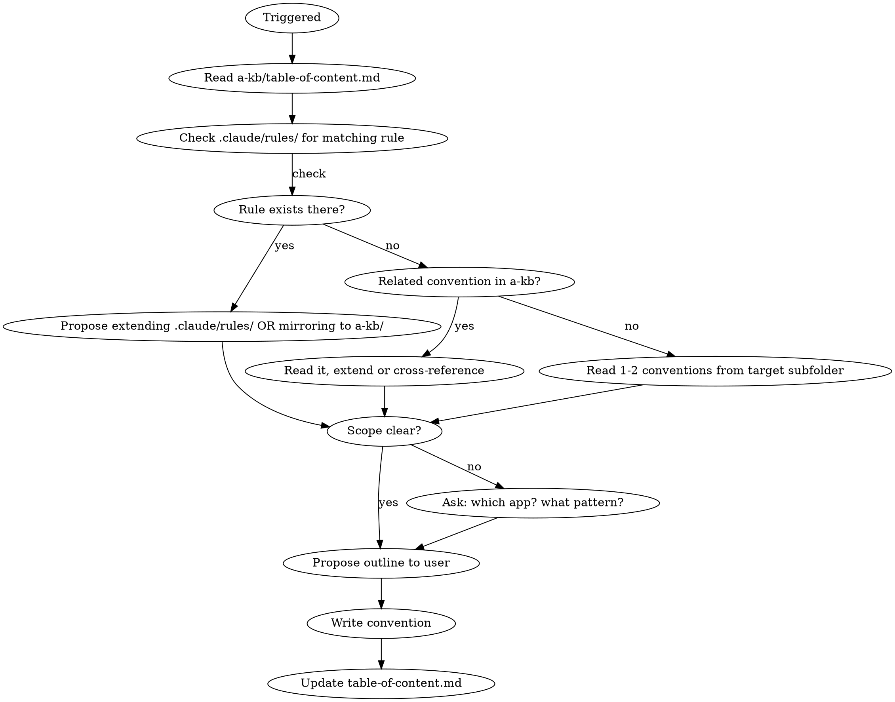

# Conventions Writer

Write coding conventions for the `a-kb/conventions/` knowledge base.

## Overview

Conventions document **how code should look** — prescriptive rules with rationale. They are principles-first: WHY before HOW, with DO/DON'T code comparisons.

## Process



1. **Read TOC**: Read `a-kb/table-of-content.md`. Check if a related convention exists.
2. **Cross-reference `.claude/rules/`** (MANDATORY before declaring any gap): the project has a second convention store at `.claude/rules/*.md` that is auto-loaded into agent context on matching file paths. Many "missing" conventions actually live there. Before reporting a gap:
   - List `.claude/rules/` (e.g. `ls .claude/rules/`).
   - Read the frontmatter `description:` of each file to find topic overlap with what's being asked.
   - If a rule file covers the topic, **prefer extending `.claude/rules/{matching-file}.md`** over creating a new `a-kb/conventions/` file — rules are what actually shape agent behavior at tool-call time; `a-kb/` is human-facing reference.
   - When proposing gaps, say explicitly: "Covered in `.claude/rules/{file}.md`" or "Partially covered — suggest extending `.claude/rules/{file}.md` with {X}" or "Not covered anywhere — new file at {location}".
3. **Read blueprints**: Read 1-2 existing conventions from the target subfolder to absorb the style.
   - Shared: `a-kb/conventions/shared/general.md`, `a-kb/conventions/shared/testing.md`
   - Home: `a-kb/conventions/home/file-folder.md`
   - Platform API: `a-kb/conventions/platform-api/rest-route-handler.md`
4. **Determine scope** — only ask if ambiguous:
   - `shared` — both apps or technology-agnostic
   - `home` — React/Next.js frontend only
   - `platform-api` — Hono/Prisma backend only
5. **Propose outline**: Show the user headers-only before writing.
6. **Write** to `.claude/rules/{file}.md` (extend) OR `a-kb/conventions/{subfolder}/{kebab-case-title}.md` (new human-facing doc).
7. **Update TOC** in `a-kb/table-of-content.md` under the correct subsection. If the new/extended rule lives in `.claude/rules/`, also add a TOC entry pointing to it so humans can discover it.

## Document Format — Principles-First

### Single-rule convention:
```markdown
# {Declarative Rule as Title}

{WHY — 1-3 sentences explaining the principle and rationale}

## DO
\```{language}
// Correct approach
{code example}
\```

## DON'T
\```{language}
// Wrong approach
{code example}
\```

## Why This Matters
- {Concrete consequence of violating this}
- {Benefit of following this}
```

### Multi-rule convention:
```markdown
# {Topic Name}

## {Rule 1 — Declarative Statement}
{WHY}
DO / DON'T examples

## {Rule 2 — Declarative Statement}
{WHY}
DO / DON'T examples

## Reference Files
- {Paths to codebase files that exemplify these conventions}
```

## Writing Rules

- Headers are **declarative statements**, never questions
- Rationale appears **right after** the rule, not in a separate section
- Code examples use language-tagged fenced blocks with `// ✅` and `// ❌` markers
- Cross-references use relative markdown links
- Point to **real codebase files** as examples
- One good DO/DON'T pair per rule is enough

## TOC Entry Format

```
- [{title}](conventions/{subfolder}/{filename}.md): When: {trigger condition}. What: {brief description}
```

## Quick Reference

| Element | Convention |
|---------|-----------|
| Filenames | kebab-case |
| Headers | Declarative rules, not questions |
| Code markers | `// ✅` DO / `// ❌` DON'T |
| Structure | WHY -> DO -> DON'T -> Consequences |
| Cross-refs | Relative markdown links |

## Common Mistakes

- **Writing procedures instead of conventions** — conventions say "how it should look", not "what steps to take" (use SOP for procedures)
- **Skipping the WHY** — without rationale, conventions feel arbitrary and get ignored
- **Too many examples** — one DO/DON'T pair per rule is enough
- **Generic templates** — show the concrete pattern from the actual codebase, not abstract placeholders
