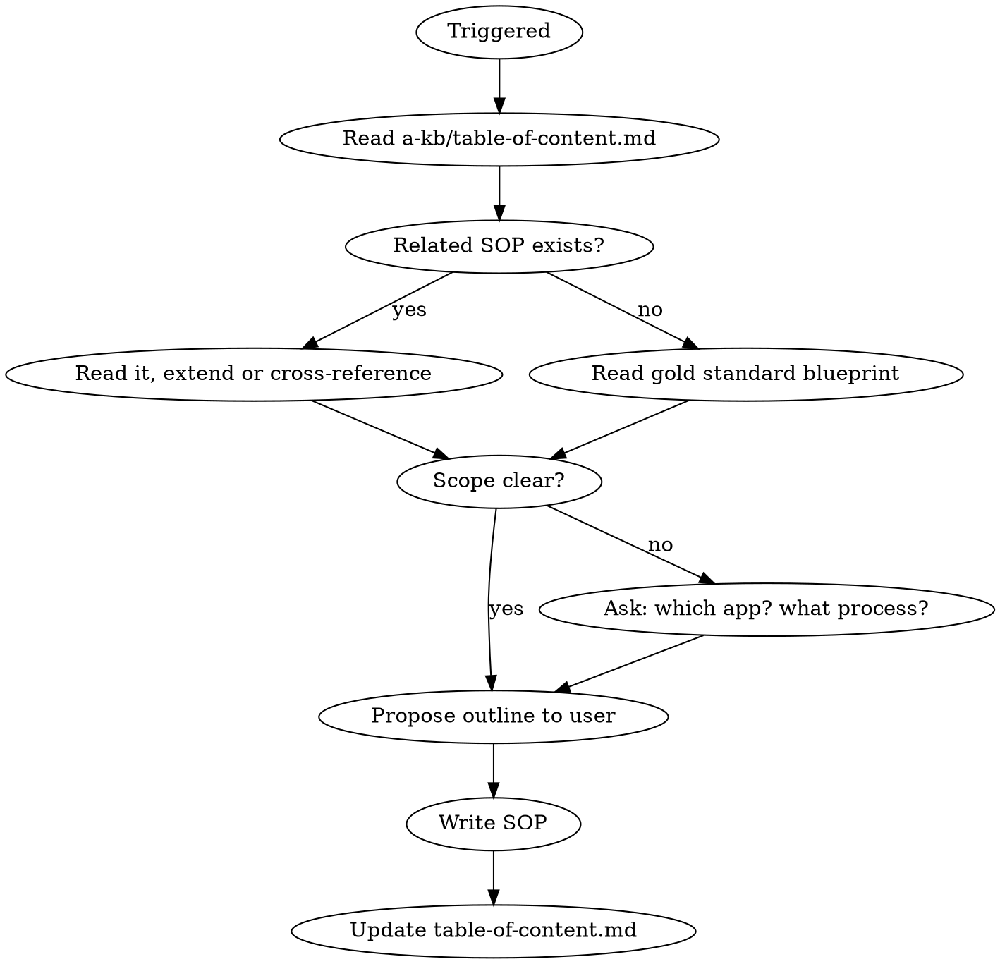

# SOP Writer

Write Standard Operating Procedures for the `a-kb/sop/` knowledge base.

## Overview

SOPs document **what steps to take** — action-oriented, sequential procedures with copy-paste commands. They answer "How do I do X?" and prevent common mistakes by making the right path obvious.

## Process



1. **Read TOC**: Read `a-kb/table-of-content.md`. Check if a related SOP exists.
2. **Read blueprint**: Read `a-kb/sop/platform-api/creating-auditable-tables.md` as the gold standard.
3. **Determine subfolder** — only ask if ambiguous:
   - `shared` — applies to both apps
   - `home` — frontend-specific process
   - `platform-api` — backend-specific process
   - `operations` — deployment, infrastructure, ops processes
4. **Propose outline**: Show the user headers-only before writing.
5. **Write** to `a-kb/sop/{subfolder}/{kebab-case-title}.md`
6. **Update TOC** in `a-kb/table-of-content.md` under the correct SOP subsection.

## Document Structure

```markdown
# SOP: {Title}

## When to Read

{1-2 sentence trigger condition — when should someone reach for this SOP?}

## Decision Point: {Question} (if applicable)

{Present choices with criteria for when to pick each. Mark mandatory decisions.}

- **Option A:** {when to choose this}
- **Option B:** {when to choose this}

## Overview (if context needed)

{Brief paragraph of context. Skip if the title + "When to Read" make it obvious.}

## Steps

### 1. {Step title}

{Brief description of what this step accomplishes.}

\```bash
{copy-paste command}
\```

{Any verification or expected output after this step.}

### 2. {Step title}
...

## Common Mistakes

**{mistake description}**
\```{language}
{wrong code or command}
\```
{explanation of why this is wrong and what happens}

## Verification Checklist

- [ ] {Verification item 1}
- [ ] {Verification item 2}

## Examples to Follow

- {File paths in codebase that exemplify the correct outcome}
```

## Writing Rules

- **Write only what is useful** — every sentence earns its place
- **Prefer concise instruction over examples** — but use examples when the right way isn't obvious
- **Commands must be copy-pasteable** — full commands, not fragments
- **Mark mandatory steps** — bold critical warnings, use "CRITICAL:" prefix
- **Decision Points before Steps** — if there's a fork, resolve it before the procedure
- **Verification after each significant step** — "Expected output:" or "Verify:"
- **Offer file examples to follow** — point to real codebase files

## TOC Entry Format

Under the appropriate subsection (`### Shared`, `### Home`, `### Platform API`):
```
- [{title}](sop/{subfolder}/{filename}.md): When: {trigger condition}
```

## Common Mistakes

- **Writing conventions instead of procedures** — SOPs are "do this, then that", not "code should look like this" (use conventions-writer for that)
- **Missing the Decision Point** — if there's a fork in the process, surface it explicitly at the top
- **Commands that need modification** — if a command has placeholders, mark them clearly: `{your_model_name}`
- **Forgetting Verification Checklist** — readers need to confirm they did it right
