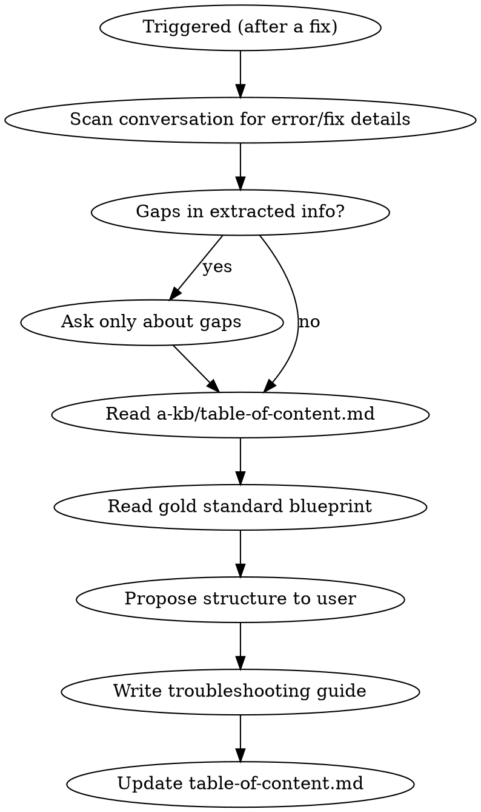

# Troubleshooting Writer

Write troubleshooting guides for the `a-kb/troubleshooting/` knowledge base. These capture the full diagnostic journey — from error message to verified fix — so the next person encountering the issue can resolve it fast.

## Overview

Troubleshooting docs are written **after fixing a recurring issue**. They capture the problem, how to confirm it, and how to fix it. The skill extracts this from the conversation where the fix just happened.

## Process



1. **Extract from conversation**: Scan the current session for error messages, symptoms, root cause, diagnosis commands, and the solution that worked.
2. **Fill gaps**: Only ask the user about information the conversation doesn't cover (e.g., "What prevention steps would avoid this in the future?").
3. **Read TOC**: Read `a-kb/table-of-content.md` to check for related troubleshooting docs.
4. **Read blueprint**: Read `a-kb/troubleshooting/docker-compose-database-volume-mismatch.md` as the gold standard structure.
5. **Propose**: Show the user the proposed structure before writing.
6. **Write** to `a-kb/troubleshooting/{kebab-case-title}.md` (flat directory, no subfolders).
7. **Update TOC** in `a-kb/table-of-content.md` under `## Troubleshooting`.

## Document Structure

Every troubleshooting guide follows this exact structure:

```markdown
# {Descriptive Problem Title}

## Problem

{1-2 sentence description of what goes wrong.}

**Example Errors:**
\```
{Exact error messages as they appear in terminal/logs}
\```

**Symptoms:**
- {Observable sign 1}
- {Observable sign 2}

## Root Cause

{Technical explanation of WHY this happens. Be specific.}

## Diagnosis

{Numbered commands to confirm you have this specific issue:}

**1. Check X:**
\```bash
{diagnostic command}
\```

**Bad (confirms issue):** {what bad output looks like}
**Good:** {what healthy output looks like}

## Solution

**Option A: {Recommended approach}**

\```bash
{solution commands}
\```

**Option B: {Alternative}** (if applicable)

\```bash
{alternative commands}
\```

## Prevention

1. {Preventive measure}
2. {Preventive measure}

## Quick Verification

\```bash
{single command to confirm the fix worked}
\```

Expected output: {what success looks like}

## Related

- [{related-doc}]({relative-path}) — {why it's related}
```

## Writing Rules

- **Exact error messages** — quote them exactly as they appear, in code blocks
- **Diagnosis before solution** — reader needs to confirm they have the right problem first
- **Multiple solutions** — offer alternatives with "recommended" marked when applicable
- **Prevention is mandatory** — every guide must explain how to avoid the issue
- **Quick Verification is mandatory** — one command to confirm the fix worked
- **No fluff** — every sentence earns its place

## TOC Entry Format

```
- [{kebab-case-name}](troubleshooting/{filename}.md): {1-line symptom description}
```

## Common Mistakes

- **Skipping the Diagnosis section** — without it, readers apply fixes blindly to the wrong problem
- **Vague error messages** — "database error" is useless; quote the exact error text
- **Missing Prevention section** — the whole point is to stop this from recurring
- **Writing it as a narrative** — "First I tried X, then I tried Y" is wrong. Write the direct path to the fix.
