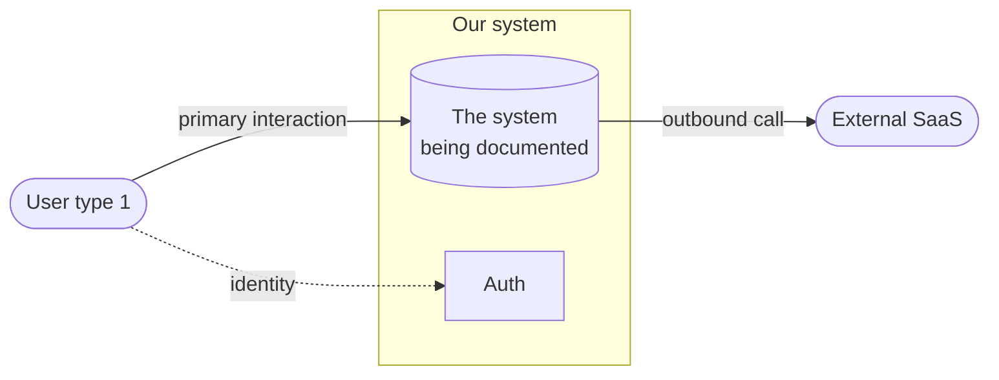
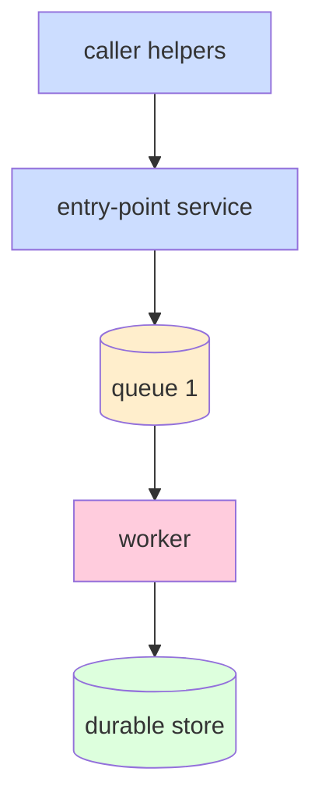
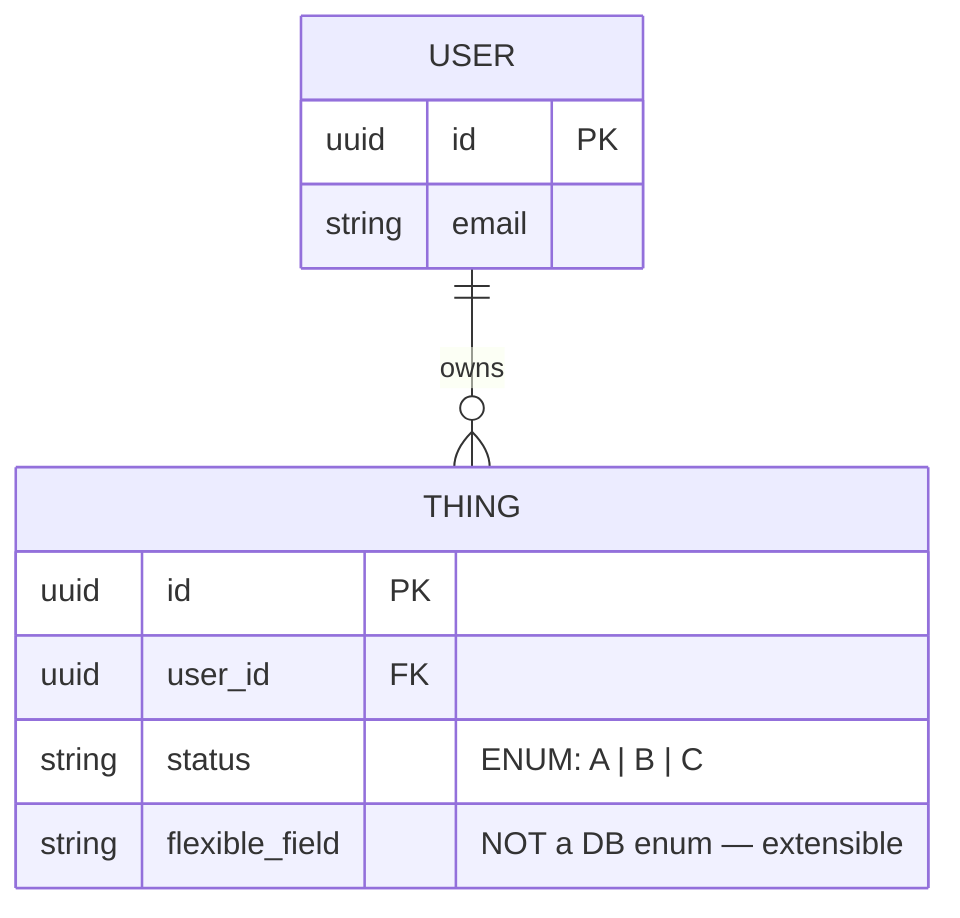
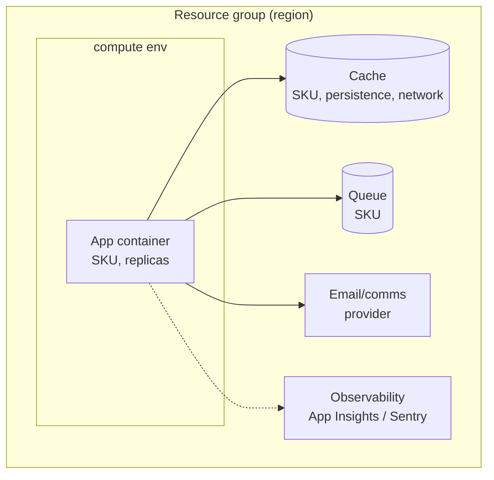
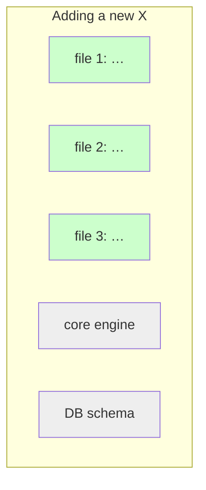

# Diagram Catalog

Which Mermaid diagram for which architectural concern. Pick by what the *reader* needs to do with it, not by what's most impressive.

## Quality bar

Every diagram must pass two tests:

1. **The whiteboard test.** Can the reader redraw it from memory in 60 seconds? If not, you've packed too much in one diagram. Split it.
2. **The "memorize this" test.** After every diagram in `diagrams.md`, write a small `**Memorize:**` block calling out what the reader should retain. The diagram is the visual aid; the bullets are the takeaway.

## The catalog

Default set for a `diagrams.md` is 6-9 diagrams, picked from this menu:

### 1. C4 Context — the 30-second "what does it do"

When to use it: always. This is the first diagram.



Shows: the system, its users (one node per user role), external services it talks to, the auth boundary. No internal components.

Memorize: "two user types, one email provider, one auth, several feature modules calling in" — the elevator-pitch shape.

### 2. Component view — inside the system

When to use it: always. This is the second diagram. The thing you'll be asked to walk through.



Shows: every internal component the reader will encounter — API surface, queues, workers, stores, channels, external integrations. Color-code by class (API / queue / worker / store / external).

Memorize: "N queues, M workers, P tables, Q channels."

### 3. Sequence — happy path

When to use it: always include one. Pick the most common business event end-to-end.

```mermaid
sequenceDiagram
    autonumber
    participant U as User
    participant API as Route handler
    participant DB as DB
    participant Q as Queue
    participant W as Worker
    participant Ext as External service

    U->>API: action
    API->>DB: BEGIN; INSERT; COMMIT
    API->>Q: enqueue
    API-->>U: 200 OK
    Note right of U: response NOT blocked

    Q->>W: pull
    W->>DB: SELECT batch
    W->>Ext: deliver
    W->>DB: UPDATE status
```

Shows: where the request response lives (numbered line, marked "NOT blocked"), the fan-out point, the side-effect boundaries. Use `autonumber` so you can refer to lines verbally in the interview.

Memorize: the line number where the response returns. "Everything after line N is async."

### 4. Sequence — an interesting edge case

When to use it: when there's a subtle correctness detail (e.g. toggle reversal, retry idempotency, race condition handling). This is the diagram you flex on.

Same Mermaid syntax. Show the *unusual* flow — the one a less careful design would get wrong.

Memorize: the trick. The 1-sentence explanation of why this case is correct.

### 5. State machine — for any lifecycle-bearing entity

When to use it: when entities have non-trivial state transitions (notification status, order workflow, document lifecycle).

```mermaid
stateDiagram-v2
    [*] --> S1 : event A
    S1 --> S1 : self-loop (idempotent)
    S1 --> S2 : event B (terminal)
    S2 --> S1 : conditional re-open

    note right of S1 : index 1: WHERE state='S1'
    note right of S2 : index 2: WHERE state='S2'
```

Shows: states, transitions with their trigger events, terminal states, self-loops. Use `note right of` to attach implementation detail (e.g. which index governs that state).

Memorize: which transitions are reversible. Which are terminal.

### 6. ERD — the data model

When to use it: always. People remember tables.



Shows: tables, columns with types, primary/foreign keys, and *short inline notes* on fields with non-obvious shape (e.g. "NOT a DB enum — extensible" or "stored as JSONB to allow forward-compatible shape changes").

If there are partial indexes, list them as a code block after the diagram — Mermaid ERD can't express them.

Memorize: count of tables, the relations, the non-obvious column choices and why.

### 7. Deployment / topology — where this runs

When to use it: for cloud-hosted systems. Often skipped in pure code documentation; essential when there's any infra surface the reader should know about.



Shows: the resource group, compute target, data stores, external integrations, observability. Annotate each with SKU/tier/replica count where it matters.

Also valuable: a **"what's NOT here"** block listing services checked-and-empty. *"No Service Bus, no Event Grid, no Notification Hubs."* Disarms the interviewer asking "did you consider X?"

Memorize: "two services do all the work: X and Y. One container hosts everything."

### 8. Pluggability deltas — what changes when you add a new (action / channel / module / variant)

When to use it: when extensibility is a story-worthy feature. Optional but powerful.



Shows: the files that change and the files that don't, side by side. Visually proves the pluggability claim.

Memorize: "adding a new X = N file touches, no migration."

## How to assemble `diagrams.md`

Always: §1 C4 context, §2 component view, §3 happy-path sequence, §6 ERD.

Add when applicable: §4 interesting-case sequence, §5 state machine, §7 deployment, §8 pluggability deltas.

Order them by zoom level: outside → inside → flow → state → data → infra → extension. The reader gets context before detail.

## Mermaid notes

- **Use `flowchart LR` for context (left-to-right reads like a story) and `flowchart TB` for component view (top-to-bottom puts the entry point at the top).**
- **Color-code consistently across diagrams.** API blue, worker pink, queue yellow, store green, external grey.
- **Sequence diagrams use `autonumber`** so you can point to "line 5" verbally.
- **Don't put more than ~12 nodes in one diagram.** Past that, the whiteboard test fails. Split into a higher-level view + a focused sub-view.
- **Notes (`note right of`, `note over`) carry the design intent.** Use them sparingly but liberally enough that the diagram doesn't need accompanying prose to be understandable.

## Anti-patterns

### "The everything diagram"

One Mermaid diagram with 40 nodes, 6 colors, 8 swim lanes. Unreadable on a whiteboard, untellable in an interview. Split.

### "The class diagram nobody asked for"

OO class diagrams almost always belong in code, not in architecture docs. Skip unless the OO hierarchy is itself a design decision.

### Diagram without a takeaway

Every diagram in `diagrams.md` should end with a `**Memorize:**` block. If you can't articulate what the reader should retain, the diagram isn't pulling its weight.
