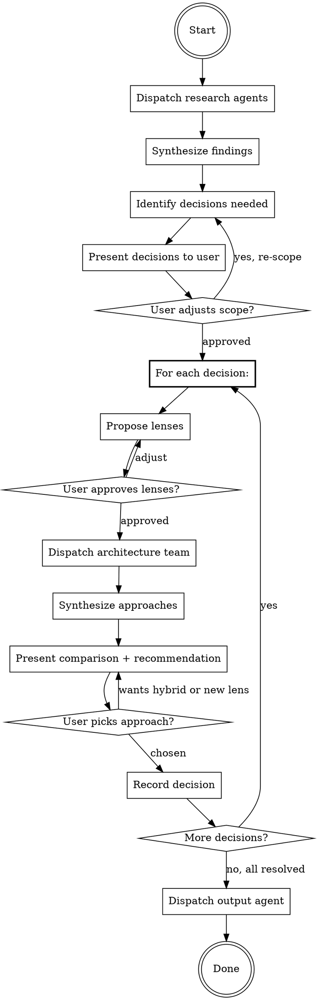

# Architect Solution

## Overview

Team-orchestrated process to resolve architecture decisions through multi-perspective exploration. Launches parallel code-architect agents with strongest module and max effort, each constrained to a different design lens, then synthesizes into a comparison for interactive decision-making with the user.

**Core principle:** Multiple constrained perspectives surface trade-offs that a single "best guess" misses. The user decides — agents explore.

## When to Use

- plan-prep gap analysis has "needs creation" or "needs modification" items
- Multiple valid architecture approaches exist and trade-offs aren't obvious
- User needs to compare approaches before the plan-prep task breakdown creates tasks
- Schema, API, or component design decisions with competing concerns

## When NOT to Use

- Decision is obvious (one clear approach, no real trade-offs)
- Bug fix or hotfix (use debug skill instead)
- Pure UI decisions (use ui-design instead)

## Deliverables

1. **architecture-decisions.md** in work folder -- each decision with context, approaches explored, comparison, chosen approach, rationale

## Team Composition

Dispatch agents based on what the decision needs. Not all agents are needed for every decision.

### Research Agents (parallel, background)

Dispatch before architecture exploration to gather raw material.

| Agent | When to dispatch | What it does |
|-------|-----------------|--------------|
| **Context reader** | Always | Reads codebase patterns, similar features, module boundaries, conventions from a-kb/ |
| **Constraint reader** | Schema/API/compliance involved | Reads schema.zmodel, API routes, access policies, compliance requirements |
| **Doc reader** | Requirements or plan-prep exist | Reads requirements.md, plan-prep.md, extracts decisions needed and constraints |

### Main Thread (interactive, sequential)

The main thread does NOT do research or architecture design -- it orchestrates, synthesizes, and drives decisions with the user.

**The main thread:**
1. Presents research findings
2. Identifies decisions needed
3. Proposes lenses per decision (user approves/adjusts)
4. Dispatches architecture team
5. Synthesizes approaches into comparison
6. Forms recommendation with rationale
7. Presents to user for decision
8. Records chosen approach

### Architecture Team (parallel, per decision)

For each decision, launch N code-architect agents in parallel. Each receives the same context but a different lens constraint in its prompt.

**Agent count is dynamic** -- determined by decision complexity:

| Complexity | Agent count | Signal |
|-----------|------------|--------|
| Simple | 2 | One obvious dimension (e.g., extend vs new) |
| Standard | 3 | Multiple concerns but clear dimensions |
| Complex | 4-5 | Many competing concerns, compliance, performance, accessibility |

### Output Agent (after decisions made)

| Agent | When to dispatch | What it does |
|-------|-----------------|--------------|
| **Decision writer** | All decisions resolved | Writes architecture-decisions.md with full context, comparison, and rationale |

## The Architecture Resolution Loop



## Step-by-Step Process

### Step 1: INTAKE

Read the work folder for context:
- `plan-prep.md` -- gap analysis section (look for "needs creation", "needs modification", reuse/modify/create classifications)
- `requirements.md` -- acceptance criteria, constraints
- Any existing `ui-design/`, `view-model-props.md`

If no plan-prep.md exists, ask the user what decisions need to be made.

### Step 2: RESEARCH (parallel agents)

Dispatch research agents based on what exists. Each agent returns findings to the main thread.

**Context reader prompt pattern:**
> "Analyze the codebase for patterns relevant to [decision area]. Find similar features, existing abstractions, module boundaries, and conventions. Report: patterns found (with file:line references), similar features, key abstractions, constraints from existing architecture."

**Constraint reader prompt pattern:**
> "Read schema.zmodel, API routes, and access policies relevant to [decision area]. Report: data model constraints, relationship patterns, access control patterns, compliance considerations (PIPEDA)."

### Step 3: SCOPE (interactive)

Present to the user:
1. Decisions identified from gap analysis
2. Research summary per decision
3. Proposed complexity rating (simple/standard/complex)

User confirms or adjusts: add/remove decisions, change complexity, add constraints.

### Step 4: LENS SELECTION (interactive, per decision)

For each decision, propose lenses based on the decision's domain. Lenses are **design philosophies that constrain the agent's exploration**, not fixed categories.

**Common lens patterns:**

| Decision Domain | Candidate Lenses |
|---|---|
| New service/module | Minimal change, Clean architecture, Pragmatic balance |
| Schema change | Additive-only, Migration-heavy, Denormalize |
| UI component | Extend existing, New component, Composition pattern |
| Performance concern | Cache-first, Denormalize reads, Lazy-load, Edge compute |
| Security/compliance | Minimal exposure, Defense-in-depth, Zero-trust |
| Integration | Adapter pattern, Direct coupling, Event-driven |
| Data flow | Push-based, Pull-based, Hybrid |

**User can:**
- Accept proposed lenses
- Remove lenses that don't apply
- Add custom lenses ("also explore an approach that prioritizes accessibility")
- Adjust agent count

### Step 5: ARCHITECTURE TEAM (parallel agents)

For each decision, dispatch N code-architect agents simultaneously. Each agent gets:

1. **Shared context:** Research findings, requirements, constraints, codebase patterns
2. **Lens constraint:** A specific design philosophy that shapes all their choices

**Agent prompt pattern:**
> "You are exploring an architecture approach for: [decision description]
>
> **Your design lens: [LENS NAME]**
> [Lens description and what it optimizes for]
>
> **Constraint:** All your choices must favor [lens priority]. When trade-offs arise, choose [lens priority] over other concerns. Be explicit about what you're trading away.
>
> **Context:**
> [Research findings, requirements, codebase patterns]
>
> **Deliver:** Patterns found, your architecture decision under this lens, component design, implementation map, data flow, build sequence, and explicit trade-offs."

### Step 6: SYNTHESIS (main thread)

Collect all agent outputs. Build comparison:

**Comparison matrix format:**

```
| Criteria              | Approach 1: [Name] | Approach 2: [Name] | Approach 3: [Name] |
|-----------------------|--------------------|---------------------|---------------------|
| Complexity            | [low/med/high]     |                     |                     |
| Risk                  |                    |                     |                     |
| Reuse of existing     |                    |                     |                     |
| Testability           |                    |                     |                     |
| Accessibility impact  |                    |                     |                     |
| Files changed/created |                    |                     |                     |
| Migration needed      |                    |                     |                     |
| PIPEDA compliance     |                    |                     |                     |
```

**Form a recommendation** with rationale. Be opinionated -- pick the approach you'd choose and explain why. But present all approaches fairly.

### Step 7: DECISION (interactive)

Present to the user:
1. Each approach summarized (3-5 bullets: what it does, key trade-off)
2. Comparison matrix
3. Your recommendation with rationale

User can:
- Pick an approach
- Request a hybrid ("approach 2's data model with approach 1's API surface")
- Request a new lens ("none of these consider X, explore that")
- Ask clarifying questions about any approach

If user requests hybrid or new lens, dispatch additional agents and re-synthesize.

### Step 8: OUTPUT

After all decisions are resolved, write `architecture-decisions.md` to the work folder.

**Output format:**

```markdown
# Architecture Decisions

> Generated by architect-solution from plan-prep.md

## Decision 1: [Title]

### Context
[What needs to be decided and why]

### Approaches Explored

#### Approach 1: [Name] -- [Lens]
- [Key design choices]
- **Pros:** [strengths]
- **Cons:** [trade-offs]

#### Approach 2: [Name] -- [Lens]
...

### Comparison
[Matrix from Step 6]

### Decision
**Chosen: [Approach name]**

**Rationale:** [Why this approach, what trade-offs accepted]

**Implementation implications:**
- [Key files/components affected]
- [Migration or schema changes needed]
- [Testing considerations]

---

## Decision 2: [Title]
...
```

## Common Mistakes

| Mistake | Fix |
|---------|-----|
| Running architect-solution for obvious decisions | Skip it -- if there's one clear approach, just document it in plan-prep |
| Fixed 3 lenses for every decision | Lenses are dynamic -- match them to the decision domain |
| Agents exploring without constraints | Each agent MUST have a lens constraint, otherwise they converge on the same answer |
| Synthesizing without recommendation | Always form an opinion -- the user wants guidance, not just options |
| Skipping user approval of lenses | Lenses shape the exploration -- wrong lenses waste agent work |
| Recording decision without rationale | Future readers need to know WHY, not just WHAT |
