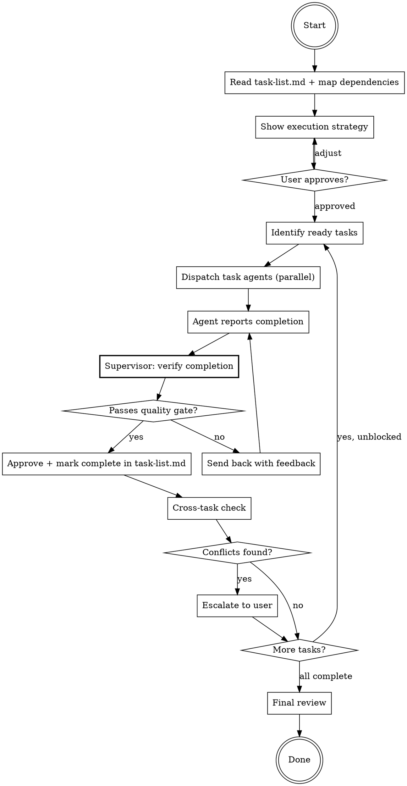

# Execute All — Supervised

## Overview

Team-orchestrated execution of a full `task/` folder. Dispatches task agents in parallel based on the dependency graph in `task-list.md`, but the main thread acts as a **supervisor** — verifying each task's completion quality before approving it and unblocking dependents.

**Core principle:** The main thread is a tech lead, not a dispatcher. It reviews agent work the way you would — checking that every `## Verification` subsection's checkboxes are actually `- [x]`, that code review findings were addressed, and that cross-task changes don't conflict.

## Inputs

The user provides:
- **Path to a work folder** containing a `task/` subfolder with `task-list.md` and `task-NN.md` files

The supervisor resolves:
- `task-list.md` — the index, dependency waves, and status tracker
- `task-NN.md` — each individual task file (Context / Implementation / Verification / Post verification tasks)
- `walkthrough.md` — running log (created if missing)

## When to Use

- Executing a full `task/` folder with multiple tasks
- Tasks have dependencies that need scheduling
- You want supervised quality gates between tasks

## When NOT to Use

- Single task execution — use `executing-single-plan-task` instead
- Tasks are all independent with no quality concerns — use subagent-driven-development instead

## Team Composition

### Task Agents (parallel, dispatched per task)

Each agent executes one task using the `executing-single-plan-task` skill. They implement, test, and run verifications independently. Each agent is handed the path to its specific `task-NN.md` plus the work folder.

### Supervisor Thread (main thread, sequential per completion)

The main thread does NOT implement — it orchestrates, verifies, and decides.

**The supervisor:**
1. Reads `task-list.md` and maps the dependency graph into execution waves
2. Dispatches ready tasks in parallel
3. When a task agent reports completion: **verifies before approving**
4. Checks cross-task coherence
5. Approves or sends back with feedback
6. Dispatches newly unblocked tasks
7. Escalates ambiguous issues to user

## The Supervised Execution Loop



## Step-by-Step Process

### Step 1: ANALYZE

1. Read `task/task-list.md` and `walkthrough.md` (if exists)
2. For each task entry in `task-list.md`, read its `task-NN.md` and extract the `Depends on:` line from the `## Context` section to build the DAG
3. Identify execution waves (tasks that can run in parallel)
4. Present to user:
   - Wave 1: [tasks with no dependencies]
   - Wave 2: [tasks depending on wave 1]
   - ...
   - Estimated parallelism: "N tasks across M waves"
5. Get user approval before starting

### Step 2: DISPATCH

For each wave, dispatch all ready task agents in parallel:

**Worktree Isolation:** When dispatching parallel task agents, use `isolation: "worktree"` to give each agent an isolated copy of the repo. This prevents file conflicts when multiple agents modify files concurrently. Each agent works in its own worktree and changes are merged back when the task completes.

**Agent prompt pattern:**
> "Use the executing-single-plan-task skill exactly as written.
>
> Work folder: [path]
> Task file: [path]/task/task-NN.md
> Task: Task NN: [Name]
> Previous tasks completed: [list]
> Walkthrough context: [key decisions from completed tasks]"

**Scheduling rules:**
- No dependency? Start immediately
- All dependencies approved by supervisor (marked `[x]` in `task-list.md`)? Start immediately
- Any dependency not yet supervisor-approved? Wait
- Multiple tasks ready? Dispatch all in parallel

**Important:** A task is only "complete" for dependency purposes when the **supervisor approves it** and marks it `[x]` in `task-list.md`, not when the agent reports done.

### Step 3: VERIFY (per task completion)

When a task agent reports completion, the supervisor reviews the report. This is the quality gate.

**Verification gate — read the task file, check every checkbox across three sections:**

The task's `## Implementation`, `## Verification`, and `## Post verification tasks` sections all contain `- [ ]/[-]/[x]` checkboxes. The supervisor's job is simple: read `task-NN.md` and check that every checkbox across ALL three sections is `- [x]`. A single `[ ]` or `[-]` anywhere means the task is not done.

| Check | What to look for |
|-------|-----------------|
| **Every `## Implementation` checkbox is `[x]`** | Includes every Tests (What to Test) item and every Steps item. If any is `[ ]` or `[-]`, the agent didn't finish building. |
| **Every `### Automation tests` item is `[x]`** | If ANY test checkbox is unchecked, send the agent back. |
| **Every `### Code review` item is `[x]`** | Each code review agent listed must have run. If findings required fixes, those should appear as `## Post verification tasks` items, now all `[x]`. |
| **Every `### QA` case's `[ ] Pass` is `[x]`** | Every inline QA case must pass. If the case requires a browser, the agent must have used a browser. |
| **Every `### Others` item is `[x]`** | biome, type-check, and any task-specific commands. |
| **Every `## Post verification tasks` item is `[x]`** | If any follow-up is `[ ]` or `[-]`, the loop isn't closed. |
| **Reset rule respected** | If the task file shows Post verification tasks that are `[x]` but `## Verification` items that are still `[ ]`, the agent forgot to re-run Verification after resolving the follow-ups. Send back. |
| **Plan adherence** | Implementation matches the `## Implementation` section. No scope creep, no skipped Steps. |
| **Interface Contracts honored** | The shape declared in `## Implementation → Interface Contracts` matches what was built. |
| **Deviations documented** | If the agent deviated from the plan, the reason must be in `walkthrough.md`. |

**If every checkbox across all three sections is `[x]`:** Mark the task entry in `task-list.md` as `[x]`, update `walkthrough.md`, unblock dependents.

**If ANY checkbox is unchecked or in progress:**
- Send agent back with specific feedback: "In `task-NN.md`, the following checkboxes are not `[x]`: [list with section + item]. Resolve them and report."
- If the issue is that Post verification tasks are `[x]` but Verification wasn't re-run, remind the agent of the reset rule: adding a Post verification task requires resetting Verification, then re-running once the follow-ups are resolved.
- Max 2 send-backs per task. After that, escalate to user.

### Step 4: CROSS-TASK CHECK

After approving a task, check for conflicts with previously completed tasks:

- **File conflicts:** Did this task modify files that another completed task also modified? If so, are the changes compatible?
- **Pattern conflicts:** Did this task introduce a pattern that contradicts a pattern from another task?
- **Schema conflicts:** Did multiple tasks modify schema.zmodel? Are the changes compatible?
- **Test conflicts:** Do new tests from this task break assumptions of tests from other tasks?
- **Interface conflicts:** Does the Interface Contract of this task still match what dependents expect?

**If conflicts found:** Escalate to user with specifics. Do NOT try to resolve cross-task conflicts autonomously — the user needs to decide.

**If no conflicts:** Proceed to dispatch newly unblocked tasks.

### Step 5: PROGRESS REPORTING

After each task approval, update the user:

```
Progress: [N/M tasks complete]
Wave 1: [x] Task 01, [x] Task 02, [x] Task 03
Wave 2: [-] Task 04 (in progress), [ ] Task 05 (waiting)
Wave 3: [ ] Task 06, [ ] Task 07

Last approved: Task 03 — [1-line summary]
Currently running: Task 04
Next up: Task 05 (unblocked when Task 04 approves)
```

Keep progress concise. User should be able to glance and know the state.

### Step 6: FINAL REVIEW

When all implementation tasks are `[x]`, the auto-added final validation tasks should run in order:

1. **Grand Code Review** (`task-NN.md` for it) — executes the `code-review-team` skill over the full set of changes. Writes findings to `code-review.md` in the work folder. Its own `## Verification` must pass before moving on.
2. **Grand QA** (`task-NN+1.md`) — executes the `qa-execution` skill over `qa.md`. Its `## Verification` must pass before moving on.
3. **Write Work Review Guide** (`task-NN+2.md`) — executes the `write-review-guide` skill to generate `review-walkthrough.md`. Runs once after the review/QA cycle is clean.

After all three are `[x]` in `task-list.md`:

1. **Summary:** Tasks completed, files changed/created across all tasks
2. **Cross-cutting review:** Quick check that the full set of changes is coherent
3. **Walkthrough.md:** Ensure all decisions documented
4. **Review guide:** Present `review-walkthrough.md` to the user
5. **Next actions:** Offer review-code (full diff), test suite run, or commit

## Handling Blockers

When a task agent reports a blocker:

1. **Stop dispatching** new tasks in the same dependency chain
2. **Continue** tasks in independent chains (don't stop everything)
3. **Report to user** with context and options:
   - Fix and retry
   - Skip task (mark as skipped in `task-list.md`, update dependents)
   - Pause all execution
4. **Document** resolution in `walkthrough.md`

## Common Mistakes

| Mistake | Fix |
|---------|-----|
| Looking for `plan-tasks.md` instead of `task/task-list.md` | The format changed — use the folder |
| Trusting "all checks passed" without evidence | Read `task-NN.md` directly and verify every checkbox across Implementation, Verification, AND Post verification tasks is `[x]` |
| Approving a task that has `[x]` Verification but `[ ]` Post verification tasks | The loop isn't closed until follow-ups are resolved — send back |
| Approving a task where Post verification tasks are `[x]` but Verification items are still `[ ]` | The agent forgot to re-run Verification after fixing follow-ups — send back with the reset rule reminder |
| Approving tasks without checking findings were addressed | Review `code-review.md` entries referenced in `## Post verification tasks`, verify each is `[x]` |
| Stopping all tasks when one blocks | Only stop the dependency chain, keep independent tasks running |
| Resolving cross-task conflicts yourself | Escalate to user — cross-task decisions need human judgment |
| Skipping cross-task check for "independent" tasks | Independent tasks can still modify shared files — always check |
| Sending back more than twice | After 2 send-backs, escalate — something is fundamentally wrong |
| Marking `task-list.md` status without re-reading the task file | The source of truth is the checkboxes inside `task-NN.md` across all three sections |
