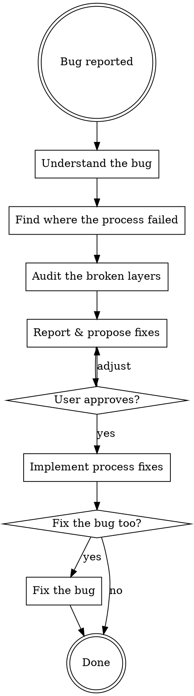

# Never Again — Fix the Process Before the Bug

When you find a bug, the real failure isn't the code — it's the process that allowed the code to ship. Fix the system first, then the symptom.

## Flow



## Step 1: Understand the Bug

If the user provided a bug description, use that. Otherwise ask only what you need:

1. **Where is the buggy code?** — File path and snippet
2. **What should it have been?** — The correct pattern/approach

Don't over-ask. If you have enough to start tracing, start tracing.

## Step 2: Find Where the Process Failed

**Goal:** Figure out what actually happened during the work that produced this bug. Understand the chain of events — what inputs the agent received, what it read, what it produced — to find where the chain broke.

**Go deep.** Don't stop at the surface. The obvious gap (e.g., "convention is unclear") is often a symptom of a deeper structural failure (e.g., "the convention lived in a folder the review process doesn't read"). Keep asking "why" until you reach the root cause.

**Be autonomous.** Discover what artifacts exist yourself. Don't assume anything exists or doesn't. Don't ask the user unless you've exhausted what you can find.

### Strategy: Trace the Execution Chain

Reconstruct the path from plan to code by finding and reading the artifacts that were involved:

1. **Find the work context** — Locate the plan/spec/review artifacts for the feature that produced the buggy code (wherever your project keeps them — a feature/work folder, a PR description, a planning doc, an issue). List what exists and read the ones relevant to the buggy file.

2. **Follow the trail** — For each artifact you find, ask: did this have the information needed to prevent the bug? Things to look for (not exhaustive — follow whatever trail emerges):
   - Did a plan or spec reference the correct pattern or convention?
   - Did it provide implementation snippets that differ from what was actually written?
   - Did a review step run? Did it check the relevant files?
   - What commands/skills were involved in producing and reviewing this code?
   - Were the right docs discoverable from where the process was looking?

3. **Check structural paths** — A doc might exist but be invisible to the process that needed it. Check whether the relevant convention/SOP/doc lives in a location where the tools and commands actually look.

### What You're Looking For

The output of this step is one or more **failure points** — specific moments where the process should have caught the bug but didn't. These are not labels or categories — they're concrete findings with evidence. For example (not exhaustive):

- "The plan gave the correct code at line X, but the agent wrote different code"
- "The convention doc was under `sop/` but the review process only reads `conventions/`"
- "The convention says 'preferred' instead of 'required' — ambiguous enough to ignore"

## Step 3: Audit the Broken Layers

Now that you know where the chain broke, read the actual process artifacts at those failure points. Typical layers exist at both project and user level — adapt the exact paths to your setup:

**Project-level (in repo):**

| Layer | Typical location |
|---|---|
| Conventions / style guides | e.g. a docs folder, a `conventions/` dir, or your wiki |
| SOPs / runbooks | e.g. an `sop/` dir or runbooks folder |
| Doc index / table of contents | the entry point that lists the above |
| Project skills | `.claude/skills/` |
| Project automated rules / hooks | `.claude/` hook or rule files (if you use them) |
| Project CLAUDE.md | `CLAUDE.md` (root and per-package) |

**User-level (outside repo):**

| Layer | Typical location |
|---|---|
| User skills | `~/.claude/skills/` |
| User commands | `~/.claude/commands/` |
| User CLAUDE.md | `~/.claude/CLAUDE.md` |
| User automated rules / hooks | `~/.claude/` hook or rule files |
| Installed plugins | plugins enabled in this session |

**Only audit layers relevant to the failure points from Step 2.** Don't audit everything.

Check both content AND location — a doc with the right content in the wrong folder is as broken as a missing doc.

## Step 4: Report Gaps and Propose Fixes

Present findings and proposed fixes together:

```
## Process Gap Analysis

**Bug:** [1-sentence description]

**Failure chain:** [What happened step by step — what the agent received, what it did, what should have caught it but didn't, and why]

### Gaps Found

1. **[Layer] — [File path or "NEW"]**
   - **Gap:** [What's missing, unclear, or misplaced]
   - **Why this matters:** [How this gap allowed the bug]
   - **Proposed fix:** [Concrete change — exact text, file move, new file content]

2. ...

### Layers Audited (no gaps)
- [Layer] — [File path] ✓
```

**Guidelines for good fixes:**
- Convention fixes: Add explicit rules with DO and DON'T examples
- Location fixes: Move the doc to where the process actually looks
- Hook/rule fixes: Write the full rule content for whatever automated-rule system you use
- Skill/command fixes: Add steps, trigger conditions, or checklist items
- CLAUDE.md fixes: Add concise directives
- Prefer the simplest fix that prevents the class of bug. A one-line convention edit or a file move beats a new skill.
- Don't create automated rules for rare one-offs — hooks are for recurring patterns.

**Present ALL fixes to user and wait for approval before implementing.**

## Step 5: Implement Process Fixes

After user approves (potentially with modifications):
- Edit existing files
- Create new files
- Move files if doc location was the issue
- Add automated rules/hooks where a recurring pattern warrants it

## Step 6: Offer Bug Fix

> "Process fixes are in place. Want me to fix the actual bug now?"

If yes, fix the bug following the now-updated process. This is the first test of the improved system.

## Anti-patterns

- **Don't skip Step 2** — Jumping to "audit convention docs" without tracing what actually happened misses the real failure
- **Don't stop at the surface** — "Convention is unclear" might be true but the deeper issue might be "the convention was in a folder the review never reads"
- **Don't assume artifacts exist** — Discover what's there, don't assume
- **Don't ask the user what you can find yourself** — Search the work artifacts, read files, trace the chain. Only ask when stuck.
- **Don't audit everything** — Focus on layers relevant to the failure points
- **Don't modify plugin code** — Plugins are external; only modify project/user artifacts
