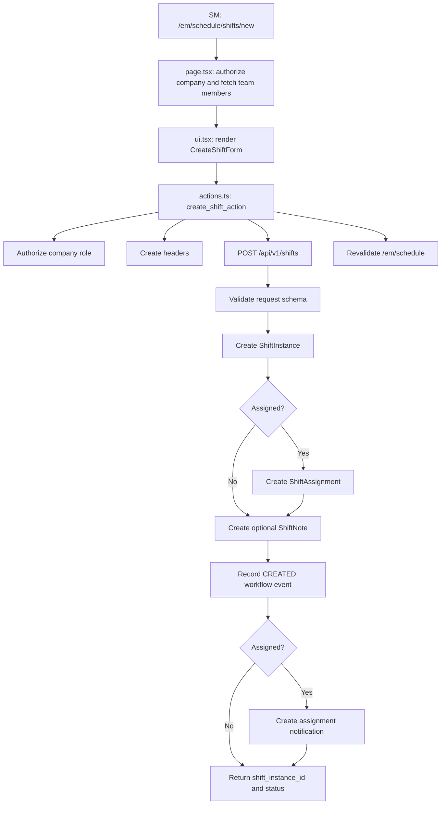

# Design Flows

> Map the desired execution flows — from entry point to output — for everything we're building.

## Memory

Read `./design-flows-memory.md` before starting. It contains learnings about flow design mistakes to avoid.

**Write to memory:** When the user corrects a flow you designed — a missing branch, wrong assumption, missed side effect — record the pattern so you avoid it on similar flows next time.

## Need

Understand how the system should work end to end, so that codebase exploration, architecture decisions, and task breakdown are all grounded in concrete flows rather than abstract requirements.

## Methods

- **Work backward from output** — Start with what's returned/displayed, trace back to data source
- **Map both current and desired state** — Makes gaps immediately visible
- **Show full data shapes** — Complete request/response/props JSON, not abbreviated
- **Track data model usage** — Which fields are used vs ignored per model
- **Engineer brings technical knowledge** — Flag flows that may be technically problematic, suggest alternatives
- **Actively surface architecture points** — For every decision made while designing flows, ask whether a senior engineer would genuinely consider more than one approach. Contribute each architecture point through `../architecture-decision-protocol.md`.
- **Incorporate design artifacts when they exist** — Use view-model-props to inform UI layer data needs
- **Always illustrate flows with Mermaid diagrams and complementary text** — Diagrams make flows concrete and reviewable

## Process

### Phase 1: List All Flows

Identify every execution flow that needs documenting based on requirements and previous components.

Present to user:

```markdown
Based on the requirements, here are the flows we need to document:

**Flows Overview:**
```

```
┌─────────────────────────────────────────────────────────────────┐
│                    Flows to Document                             │
├─────────────────────────────────────────────────────────────────┤
│                                                                 │
│  1. [Entry point] ([type: page / API / trigger / job])          │
│     └── Current: [brief description or "doesn't exist"]         │
│     └── Desired: [what we're adding/changing]                   │
│                                                                 │
│  2. [Entry point] ([type])                                      │
│     └── Current: [brief description]                            │
│     └── Desired: [what we're adding/changing]                   │
│                                                                 │
│  3. [Entry point] ([type])                                      │
│     └── Current: [doesn't exist yet]                            │
│     └── Desired: [new feature description]                      │
│                                                                 │
└─────────────────────────────────────────────────────────────────┘
```

```markdown
**Proposed Flow Order:**
1. [ ] Flow 1: [Name] — [why first]
2. [ ] Flow 2: [Name] — [depends on Flow 1]
3. [ ] Flow 3: [Name] — [independent]

Does this cover all the flows? Should I add, remove, or reorder any?
```

**Get user approval** before proceeding to Phase 2.

---

### Phase 2: Define Each Flow

**For EACH approved flow, define collaboratively one at a time.**

**Process:** Work iteratively with user. Start with output (what's returned/displayed), then work backward to how we get that output.

**Be Interactive:** Ask clarifying questions:

- When API response shape is unclear
- When edge cases need definition
- When processing logic has multiple valid approaches
- When data contracts are ambiguous

**For each flow:**

1. **Start with Output**: What gets returned/displayed? What data?
2. **Work Backward**: Where does that data come from? How is it processed/transformed?
3. **Document Current State**: What exists today (or "nothing exists")
4. **Document Desired State**: What we need to build
5. **Use Diagrams**: add Mermaid diagrams and complementary text

**Get user approval on each flow before moving to next.**

#### Per-Flow Template

For each flow, document current state then desired state:

**Current State:**

When something exists today:
- **Entry point:** `path/to/entry` or `METHOD /endpoint`
- **Execution flow** (Mermaid diagram tracing entry → auth → logic → data → side effects → return)
- **Data shapes:** Full JSON for request/response/props at each layer
- **Data models used:** Which fields are used vs ignored per model
- **What works:** Current capabilities

When nothing exists: state "Nothing exists" and move to desired state.

**Desired State:**
- **Entry point:** `path/to/entry` or `METHOD /endpoint`
- **Execution flow** (Mermaid diagram of the desired path)
- **Data shapes:** Full JSON including new/modified fields
- **New data models needed:** New fields, new models, relationships
- **What this adds:** New capabilities
- **Changes from current:** What changes at each layer (entry point, processing, data, side effects)

**Clarifying questions:** Embedded in each flow as they arise, not batched at the end.

#### Example: Desired State Flow Diagram



---

## Key Principles

- **Very high level** — no implementation details yet, just the flow
- **Show full data shapes** — complete request/response/props JSON (not abbreviated)
- **Both states** — current and desired for each flow
- **Data model usage** — what fields are used vs ignored
- **Gap identification** — what's missing becomes clear from current vs desired
- **Always use diagrams** — illustrate every flow with Mermaid diagrams and complementary text
- **Be interactive** — ask clarifying questions, don't assume
- **One flow at a time** — complete one, get approval, then next
- **Any entry point type** — pages, API endpoints, event triggers, scheduled jobs, service calls

## Output

Document in `plan-prep.md` (append after previous component):

```markdown
## Flow Design

### Flow: [Name]

### Current State: [Brief Description]

**Entry point:** `path/to/entry` or `METHOD /endpoint`

**Data Flow:**
- `function_name({ params })`
  - API: `METHOD /endpoint/path`
  - Request: [Full JSON with all fields and nested structures]
  - Response: [Full JSON with all fields and nested structures]

- `transform_function(response)`
  - Handles: [List each case - happy path, edge cases, errors]
  - Returns: [Full JSON of transformed data]

- `<ComponentName data={transformedData} />` (if UI)
  - Displays: [Full JSON of props the component receives]

**Clarifying Questions:** [List questions about unclear API shapes, edge cases, transform logic]

**Data Flow Diagram:**
[Mermaid diagram — flowchart, sequence, or state diagram, whichever best illustrates the flow]

**Data Models Used:**
- `model_name`: Used fields vs not used fields
- `related_model`: Used fields vs not used fields

**What Works:** [List current capabilities]
**What's Missing:** [List gaps]

---

### Desired State: [Brief Description]

**Entry point:** `path/to/entry` or `METHOD /endpoint`

**New Data Flow:**
- `enhanced_function({ params, new_params })`
  - API: `METHOD /endpoint/path`
  - Request: [Full JSON including new fields]
  - Response: [Full JSON including new data]

- `transform_enhanced(response)`
  - Handles: [List each case including new scenarios]
  - Returns: [Full JSON of enhanced transformed data]

- `<EnhancedComponent data={transformedData} />` (if UI)
  - Displays: [Full JSON of enhanced props]

**Clarifying Questions:** [List questions about new capabilities]

**Data Flow Diagram:** [Mermaid diagram showing the enhanced flow with new components]

**New Data Models Needed:**
- Model enhancements: [new fields]
- New models: [fields and relationships]
- ...

**What This Adds:**
- [New capability 1]
- [New capability 2]
- ...

**Changes from Current:**
- API: [What changes in API]
- Transform/Processing: [What changes in transformation or processing]
- Data: [What changes in data models]
- Side effects: [What changes in notifications, workflows, etc.]
- Component/Output: [What changes in UI or response] (if applicable)

**Questions Resolved:**
- [question] → [answer]

---

(Repeat for each flow)
```
