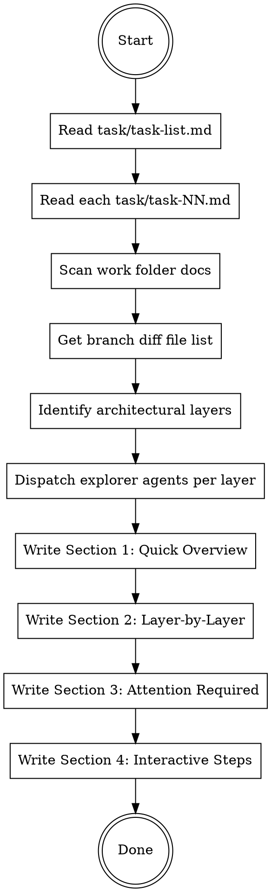

# Write Review Guide

Generate a `review-walkthrough.md` that lets a human reviewer efficiently decide what needs their attention across a large set of changes — without reading every file.

## When to Use

- All tasks in `task/task-list.md` are complete
- Auto-added as final task by plan-prep
- Before asking the user to review the work
- When the user asks for a review walkthrough of completed work

## Input

**Required:**
- `task/task-list.md` in the work folder (the implementation plan index)
- `task/task-NN.md` files (individual task details — read each for context about what was built)
- Full branch diff (`git diff main...HEAD` or equivalent)

**Also scan:**
- Everything in the work folder (architecture docs, requirements, pre-planning, `code-review.md`, `qa.md`, `walkthrough.md`)
- All files changed on the branch

## Output

**Save to:** `review-walkthrough.md` in the work folder (same directory as `task/`)

---

## Process



### Step 1: Gather Context

1. **Read `task/task-list.md`** — understand the full set of tasks, dependency waves, and completion state
2. **Read each `task/task-NN.md`** — for each completed task, extract what was built (from `## Context` and `## Implementation`), what was verified (from `## Verification`), and any follow-ups (from `## Post verification tasks`)
3. **Scan the work folder** — read `plan-prep.md`, `architecture-decisions.md`, `requirements.md`, `code-review.md`, `qa.md`, `walkthrough.md`
4. **Get the full diff** — `git diff main...HEAD --stat` for file list, `git log main..HEAD --oneline` for commit history
5. **Group changed files into architectural layers** — DB, service, queue, API routes, emit sites, email, frontend, tests, etc. The layers depend on what was built.

### Step 2: Explore Each Layer

Dispatch parallel explorer agents (one per layer) to read the actual code and summarize:
- What each file does
- Key design patterns used
- Notable decisions (raw SQL, workarounds, access control, compliance)
- Cross-references to other layers

### Step 3: Write the Document

The document has **two distinct sections** — the reviewer should be able to read Section 1 alone and be done, or dig into Section 2 if they want detail.

---

## Document Structure

### Section 1: Quick Overview (standalone — reviewer can stop here)

**1a. System Flow (30-second version)**

ASCII diagram showing the full data flow end-to-end. Not a file map — a flow of data/control through the system.

```
[Trigger] --> [Processing] --> [Storage] --> [Delivery]
```

Keep it to one diagram that fits on a screen. This is the "elevator pitch" of the architecture.

**1b. Review Plan Table**

One table summarizing all layers:

| # | Layer | Files | Focus |
|---|-------|-------|-------|
| 1 | DB Schema | schema.zmodel, migration | Models, indexes, access policies |
| 2 | ... | ... | ... |

**1c. Attention Required (most important part)**

Flag items the reviewer SHOULD look at. Categorize by risk:

| Risk | Item | Where | Why it matters |
|------|------|-------|----------------|
| Security | Raw SQL bypassing ORM | dedup-upsert.ts:33 | Partial index not expressible in Prisma |
| Compliance | Rate notifications exclude values | render-body.ts:160 | PIPEDA — no monetary data in notifications |
| Workaround | ZenStack Json? bug | update-preferences.ts:105 | Raw SQL upsert instead of Prisma upsert |
| Design | Opt-out preference model | fanout.processor.ts:72 | Missing row = enabled, only explicit disable suppresses |
| Edge case | Quarter boundary precision | scheduled-queries.ts:190 | Rule 3/4 handoff at exact quarter end date |

Categories:
- **Security** — access control, SQL injection surface, auth decisions
- **Compliance** — PIPEDA, CASL, data handling, audit trail
- **Workaround** — things that work around framework bugs or limitations
- **Design** — architectural decisions with trade-offs the reviewer should validate
- **Edge case** — boundary conditions, race conditions, unusual states

**Only flag things that genuinely need human judgment.** Don't flag routine code.

**1d. Cross-Cutting Concerns**

Table of concerns that span multiple layers:

| Concern | Where to verify |
|---------|----------------|
| Fire-and-forget | Every emit site has try/catch, service swallows errors, fanout isolates per-recipient |
| Self-notify exclusion | Fanout filters actor, emit sites exclude actor from stakeholders |
| ... | ... |

### Section 2: Layer-by-Layer Deep Dive (optional — for thorough review)

For each architectural layer:

**Layer N: [Name]**

Brief description of what this layer does (2-3 sentences max).

**Key patterns to verify:**
- Bullet list of the important design decisions in this layer
- What to look for when reading the code

**Files to review:**

| File | What to check |
|------|--------------|
| `path/to/file.ts` | Specific thing to look for in this file |
| ... | ... |

Repeat for each layer.

### Section 3: Interactive Review Steps

Numbered steps in recommended reading order. Each step says which layer to review and what to focus on. This is for reviewers who want to go through it systematically.

```
Step 1: DB Foundation — read schema.zmodel, verify indexes and access policies
Step 2: Service Core — read types.ts, understand the emit payload shape
Step 3: [Most critical path] — follow data through the pipeline
...
```

### Section 4: Known Issues / Open Questions

Bullet list of things that are known limitations, deferred decisions, or open questions the reviewer should be aware of.

---

## Layer Identification

Layers depend on what was built. Common patterns:

| If the work includes... | Layer name |
|------------------------|------------|
| schema.zmodel / migrations | DB Schema |
| Service files (emit, types) | Service Core |
| BullMQ processors | Queue / Workers |
| Route handlers | API Routes |
| Calls to service.emit() in handlers | Emit Sites |
| Email templates, ACS integration | Email Delivery |
| React components, hooks, server actions | Frontend |
| Cron jobs, scheduled queries | Scheduled Jobs |
| Test files | Tests |

Not all layers will be present. Only include layers that have changed files.

---

## Quality Checklist

- [ ] Quick Overview is standalone — reviewer can read Section 1 and stop
- [ ] System flow diagram fits on one screen
- [ ] Attention Required flags genuine risks, not routine code
- [ ] Every changed file appears in at least one layer's file table
- [ ] File references include what to check, not just the filename
- [ ] Cross-cutting concerns are identified
- [ ] Interactive steps give a clear reading order
- [ ] Known issues / open questions are listed
- [ ] No implementation details — this is a map, not a tutorial

---

## Common Mistakes

| Mistake | Fix |
|---------|-----|
| Listing every file without focus | Each file entry needs "what to check" — a specific thing to look for |
| Making Section 1 depend on Section 2 | Quick Overview must be self-contained |
| Flagging routine code as "attention required" | Only flag things needing human judgment: security, compliance, workarounds, design trade-offs |
| Writing a tutorial instead of a review guide | The reviewer knows how to code. They need a map, not an explanation |
| Missing cross-cutting concerns | These are the hardest to spot in file-by-file review — call them out explicitly |
| Generic layer descriptions | Be specific to what was actually built, not what a generic notification system looks like |
