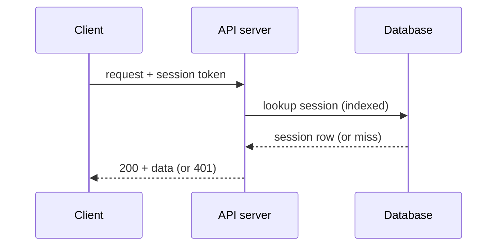

# Week 30 engineering review

**Status:** fixture for the generating-html-artifacts evals · a deliberately dense mixed document

TL;DR: the cache rewrite shipped and cut p95 latency roughly in half; one SEV-2
incident (self-inflicted, retry storm); the Postgres-vs-Redis session-store decision
is made; rollout runbook is ready. Details below.

## The week in numbers

PRs merged: 14 (up 3 vs week 29). Deploys: 6 (flat). SEV-2 incidents: 1 (up from 0 —
see the timeline). Test-suite pass rate: 99.1% (up from 97.4% after flaky-test fixes).

## Latency, exact

| Endpoint | p50 (ms) | p95 (ms) | p99 (ms) | Budget (ms) |
|----------|----------|----------|----------|-------------|
| /search  | 88       | 210      | 340      | 250         |
| /embed   | 102      | 240      | 410      | 250         |
| /index   | 130      | 260      | 455      | 300         |
| /export  | 64       | 150      | 220      | 200         |

## Latency trend

p95 across all endpoints, weekly, since the rewrite started: W23 480, W24 455,
W25 430, W26 390, W27 340, W28 310, W29 265, W30 235. The shape matters more than
the table here — show it.

## Endpoint comparison before/after

Before the cache vs after: /search 420→210, /embed 380→240, /index 510→260,
/export 190→150. The /index improvement is the headline — call it out.

## Decision: session store

We pick **Postgres with a TTL sweeper**. Comparing the three real options on the
axes the team agreed matter — ops burden, p95 read latency, failure modes, cost:

- Postgres + sweeper: no new infra, ~1 ms reads, failure modes we already monitor.
- Managed Redis: new stateful system, sub-ms reads, new failover semantics, $$.
- In-process cache: zero infra, fastest, but loses sessions on every deploy.

Why not Redis Cluster specifically? We evaluated it in Q3 — the ops overhead was
the blocker.

Redis would have been the pick if read latency dominated everything; it doesn't.
Postgres wins on ops burden and failure modes we already understand; Redis wins on
raw speed and native TTLs. Different strengths, no common scale — judge each on
its own merits.

Option A depth: sessions live in a `sessions` table with an `expires_at` index; a
1-minute sweeper deletes expired rows. Writes at peak ~800/s — well inside
headroom, but load-test before cutover.

Option B depth: managed Redis gives sub-ms reads and native TTLs. The cost is
operational: failover semantics, a new monitoring surface, and an AOF-everysec
persistence model we would have to learn before trusting it with auth state.

## Incident: the retry storm (SEV-2, July 17)

22:14 — traffic spike begins; p99 climbs past 800 ms.
22:19 — clients retry aggressively; load doubles. This is when the outage became self-sustaining.
22:31 — rate limiter deployed to staging; canary at 10%.
22:38 — rate limiter at 100%; load normalizes.
22:54 — p99 back under budget; incident closed.

Root cause: our SDK retried immediately with no cap — a spike turned into a
retry storm. The fix is deployed; the follow-ups below are not done.

Warning: a full cache flush during peak traffic can stampede the database for
30–60 s. Use the per-key invalidation endpoint during business hours.

## Follow-up actions (owners, unordered)

- Add client-side retry caps with jitter — SDK team; the missing cap caused the storm.
- Rehearse the failover runbook end to end — infra; two steps were from memory.
- Add a p99 budget alert at 80% of budget — observability; we noticed late.

## Rollout runbook (do these in order)

1. Deploy the new `sessions` schema migration; verify the `expires_at` index exists.
2. Enable dual-write (old store + new table) at 10% of traffic; watch error rates.
3. Backfill existing sessions; spot-check 100 random rows.
4. Cut reads to the new store at 50%, then 100%; keep dual-write for 48 h.
5. Drop the old store and announce in #eng-releases.

## Vocabulary for this doc

- **RRF** — Reciprocal Rank Fusion; merges ranked lists by position, not score.
- **ANN index** — approximate nearest-neighbor structure; trades recall for speed.
- **TTL sweeper** — a periodic job deleting rows whose expiry timestamp has passed.
- **Dual-write** — writing the same record to two stores during a migration window.

> "It is important that the task type is used consistently between indexing and
> querying, or retrieval quality silently degrades." — Gemini embedding docs,
> the warning that justified the embed() refactor.

## Try the new cache locally

Install per platform: on macOS it's `brew install bm-search`; on Linux, untar the
release into `~/.local/bin`; on Windows use WSL2 and follow the Linux steps. Then:

```bash
bm search "sqlite backup approach" --limit 5 --explain
```

## The retry fix, as merged

```diff
 export async function fetchWithRetry(url: string, tries = 3) {
-  for (let i = 0; i < tries; i++) {
-    try { return await fetch(url); } catch (e) { /* swallow */ }
-  }
-  throw new Error('unreachable');
+  let delay = 100;
+  for (let i = 0; i < tries; i++) {
+    try { return await fetch(url); }
+    catch (e) { await sleep(delay); delay = Math.min(delay * 2 + jitter(), 2000); }
+  }
+  return fetch(url); // last attempt surfaces the real error
 }
```

## How the backoff works, line by line

Teach the retry loop from `src/retry.ts` — the delay doubling, the 2 s cap, and
why the final fetch is deliberately unguarded:

```ts
let delay = 100;                          // starts small
for (let i = 0; i < tries; i++) {
  try { return await fetch(url); }
  catch (e) {
    await sleep(delay);
    delay = Math.min(delay * 2 + jitter(), 2000);  // capped exponential + jitter
  }
}
return fetch(url);                        // unguarded: surfaces the real error
```

## Where the pieces live

```
src/
├── retry.ts            — backoff loop above
├── cache/
│   ├── index.ts        — cache client + invalidation endpoint
│   └── sweeper.ts      — TTL sweeper job
└── search/
    ├── bm25.ts         — lexical engine
    └── embed.ts        — dense engine (task types!)
```

## System sketch

```
┌────────────┐      query       ┌────────────┐
│ web client │ ───────────────▶ │ API server │
└────────────┘                  └─────┬──────┘
                                      │ reads/writes
                                      ▼
                                ┌────────────┐
                                │  database  │
                                └────────────┘
```

## Token flow after the auth refactor



## Deploy pipeline (each stage has detail worth exploring)

Build (4 min, caches deps) → Test (11 min, parallel shards; failures quarantine
flaky tests) → Canary (10% for 30 min, auto-rollback on error-rate threshold) →
Full rollout (progressive, one region at a time). The canary stage is where the
retry-storm fix was validated.

## Load-test result (see Figure 1)

Figure 1 shows hit rate reaching 94% within ten minutes of a cold start — the
warmup cron is doing its job. [Attach the Grafana export: hit-rate curve from
cold start to steady state, annotated with the warmup window.]
